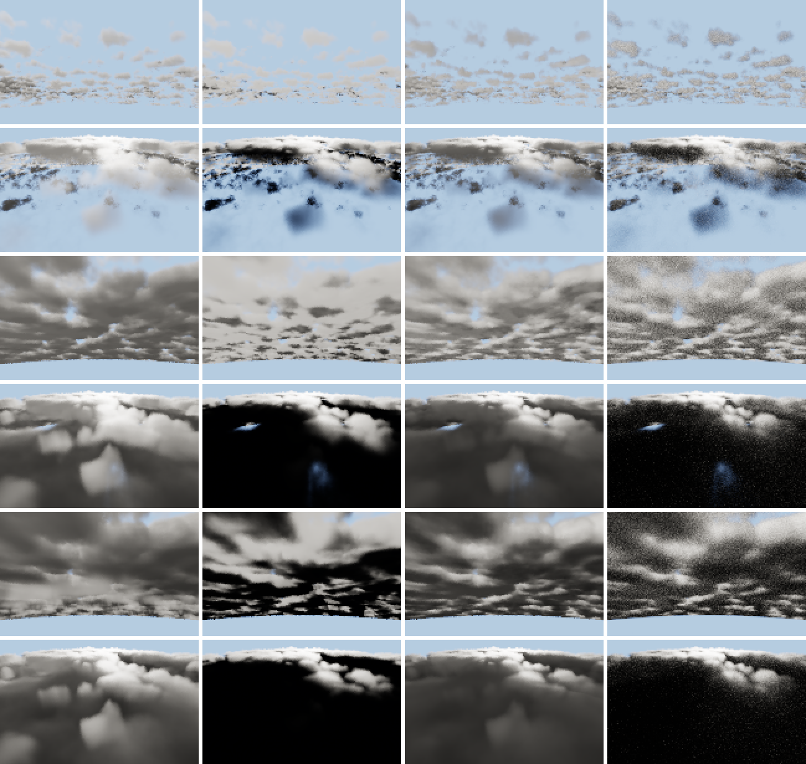
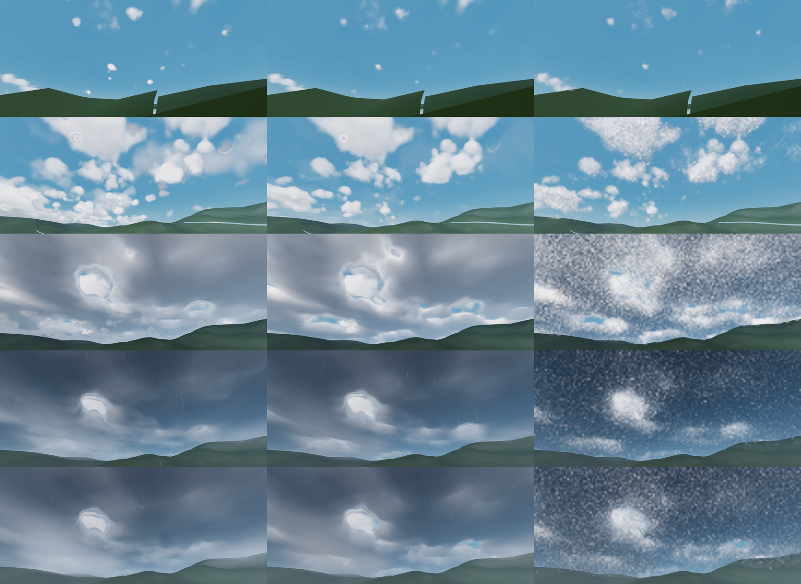
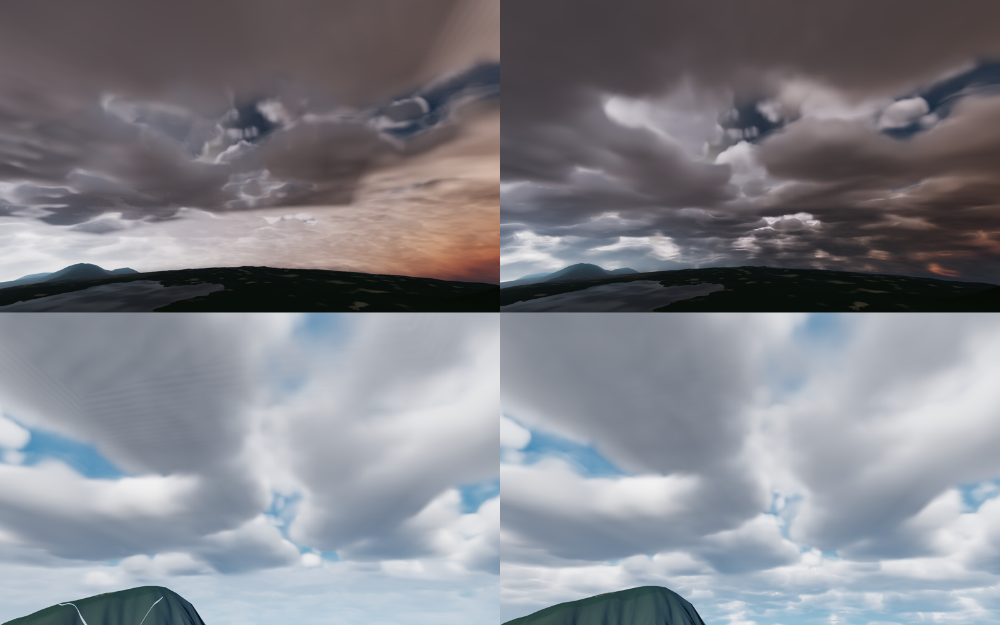
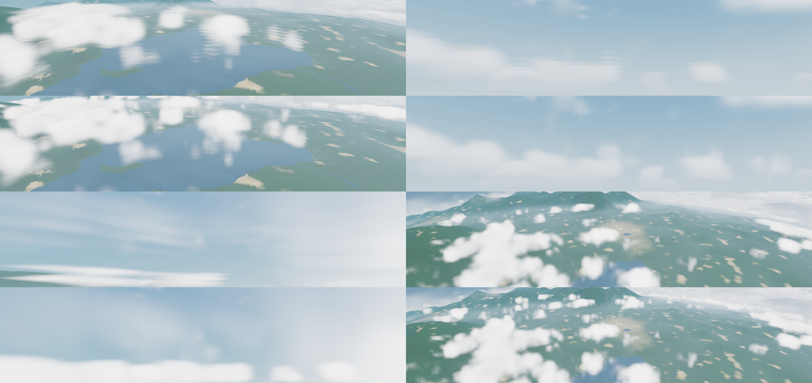
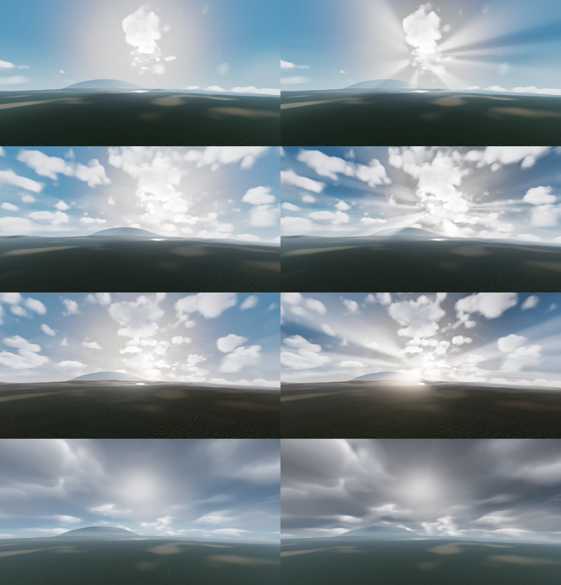
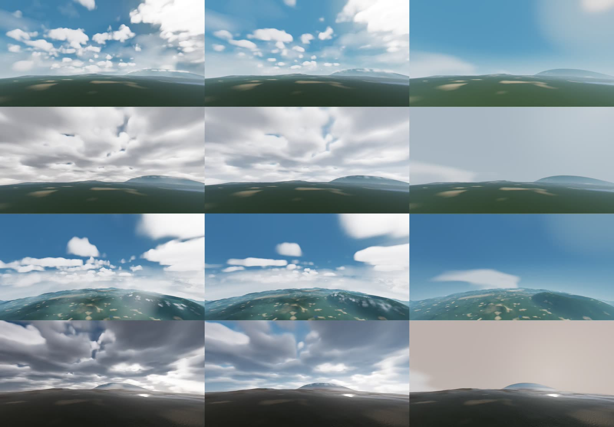
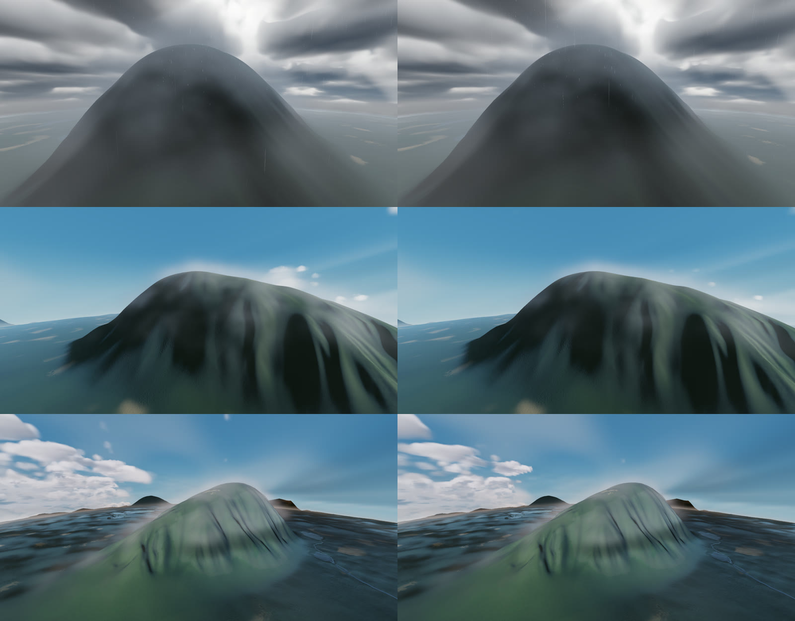
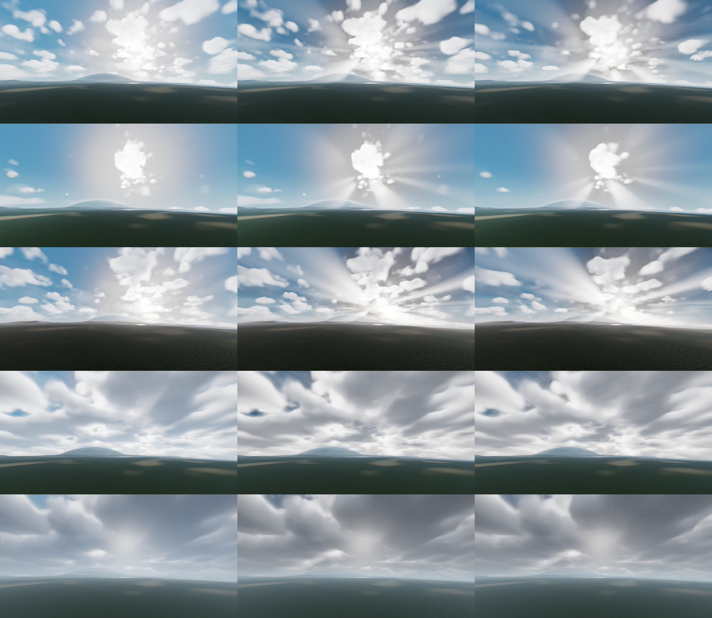

# Neural cloud lab: findings

Date: 2026-11-22. Machine: M1 Pro (Chrome WebGPU, Metal). Branch: `clouds/renderer-redesign` working tree.
Everything here is new code in `neural_lab/` (WGSL + JS) and `tools/neural/` (drivers, numpy training).
Nothing in `core/` was modified; the lab imports the game's `CLOUD_DENSITY_WGSL` read-only, so every
number below is for the game's exact cloud density field with the game's runtime look
(`wizard_game/runtimeConfigs.js`) and its weather presets.

## Summary

- A GPU path tracer over the game's exact density field (`neural_lab/teacher.wgsl.js`) now serves as the
  "beyond ultra" ground truth; a training scene takes seconds to a few minutes on the M1 Pro.
- Multiple scattering is 4-25x single scattering in every view, and the shipped octave model gets it wrong
  by a scene-dependent 0.3-2.5x; inside clouds it is uncorrelated with the truth.
- Cheapest big win is conventional: multiply sun lighting by the existing cloud shadow map
  (sun-light error 0.66 -> 0.37, fixes over-bright dusk cloud tops).
- On top of that, small networks win clearly where the analytic model is structurally wrong:
  exact single scattering + a 16-16 neural multiple-scattering term (0.24 vs 0.37 best conventional;
  2x better on daytime clouds), and a 16-16 sky-light network (0.12-0.15 vs 0.23). Image-level error
  against the path tracer: game 0.39, best conventional 0.25, neural 0.12 (mean of 8 held-out scenes).
- Both networks work without the view direction, so they can be baked into a light cache:
  ~0.7 ms/frame on the M1 Pro, while removing per-sample sky probes. Per-sample evaluation instead costs
  ~1.3 ns per lit sample (about 1.0-2.0 ms/frame at the target marcher's sample counts).
- Open: fully shadowed decks at dusk are still ~20 % too bright with the networks (under-represented in
  training); cache-resolution error untested.

## The question

Get the conventional marcher to roughly 3-4 ms, then decide where an extra 2-3 ms of neural work buys
more visual quality than spending the same time on the conventional renderer. To answer that we need
(1) a ground truth far beyond the game's lighting model, (2) the error of the shipped model against it,
(3) the error of the best *conventional* fix with the same inputs, (4) the error of small networks, and
(5) what those networks cost on this GPU.

## 1. Ground truth: a path-tracing teacher on the game's density field

`neural_lab/teacher.wgsl.js` is a volumetric path tracer that calls the game's `cloudDensity()`
directly (extinction 26 /km x density, albedo 0.99, the game's two-lobe HG phase function g = 0.8 / -0.36,
back-lobe weight 0.4). Free flight uses two-mode tracking (coarse steps through clear air, fine jittered
midpoint steps in cloud, step size adaptive to keep ~0.3 optical depth per step), next-event estimation to
a white sun of irradiance 1, sky escape (radiance 1 above the shell, 0 below), Russian roulette, up to 384
bounces (no path was ever truncated). It records, per query point:

- the exact sun source term per unit extinction, `S_sun = albedo * (single + multiple)`, and the sky
  source term `S_sky`, with their Monte Carlo variances;
- the features the game's marcher already computes at a lit sample: 6 sun-probe densities, 5 sky-probe
  densities, local/base density, cloud-local height, layer height, stratiform share, coverage, cloud type,
  view/sun angles, the probe optical depth, and the view-ray optical depth (free: the marcher's T);
- the game's own analytic terms at that point (octave sum, powder mix, in-scatter probability, sky
  visibility), so analytic and neural are compared on identical points.

Query points are sampled along real camera rays with probability proportional to their contribution to the
pixel (`T * (1 - exp(-sigma dt))`), so the data weights the visible skin of clouds the way the image does.

Validation: the adaptive fine step changes label means by < 2 % against fixed 20 m steps (within noise)
while being 11x faster in overcast. Throughput is 1.5-7k paths/s per scene type, i.e. a full 10k-point
training scene with 48 paths takes 4-50 s, and a 160x100 reference image at 256 spp takes seconds to a
couple of minutes.

Dataset: 4 weather presets (partly cloudy, cloudy, overcast, rain) x 5 views (ground, horizon, inside the
layer, above, grazing) x different sun elevations (12-65 deg) = 20 training scenes (~190k points).
Held-out test: 8 scenes at a different place on the planet (lat 11, lon 47) with sun elevations and
azimuths not used in training, 192 paths per point, plus 256-spp path-traced reference images.

## 2. How far the shipped lighting is from ground truth

Per training scene, weighted by pixel contribution (`teach/game`: path-traced brightness over the game's
sun term including its 1.89 daylight gain; `corrLog`: per-point correlation in log space):

| scene | MS / single scattering | teach/game | corrLog sun | sky (PT) | game skyVis | corr sky |
|---|---:|---:|---:|---:|---:|---:|
| fair-ground | 8.8 | 1.72 | 0.50 | 0.31 | 0.23 | 0.66 |
| fair-inside | 5.8 | 1.65 | **-0.04** | 0.68 | 0.62 | 0.50 |
| fair-grazing | 5.4 | 0.86 | 0.65 | 0.53 | 0.69 | 0.60 |
| cloudy-ground | 6.7 | 2.01 | 0.36 | 0.40 | 0.29 | 0.61 |
| cloudy-inside | 4.8 | 1.83 | **-0.16** | 0.62 | 0.54 | 0.59 |
| overcast-ground | 13.3 | 1.47 | 0.67 | 0.21 | 0.18 | 0.66 |
| overcast-inside | 6.3 | 2.05 | 0.54 | 0.48 | 0.25 | 0.70 |
| overcast-grazing | 17.0 | **2.47** | 0.55 | 0.59 | 0.18 | 0.28 |
| overcast-horizon | 24.9 | 1.42 | 0.66 | 0.18 | 0.17 | 0.61 |
| rain-ground | 22.6 | **0.32** | 0.29 | 0.06 | 0.28 | -0.01 |
| rain-above | 4.7 | 1.40 | 0.58 | 0.77 | 0.52 | 0.60 |

What this says:

- Multiple scattering is 4-25x single scattering in every view. The four-octave approximation is not a
  correction term; it is most of the visible light.
- The shipped model's brightness error is scene dependent, from 0.32x (rain undersides far too bright) to
  2.5x (overcast grazing far too dark). No global gain can fix that; the 1.89 daylight sun gain in the
  runtime look is a symptom of it.
- Inside the cloud layer the per-point correlation is about zero: the analytic model does not know which
  parts of a cloud are bright. This is the "flat / doesn't look like real clouds" complaint in numbers.

## 3. A blind spot shared by every probe-based model: low sun

The held-out "above" views sit at another longitude, so the sun is on the local horizon there. At a
horizon sun the light path to a cloud top crosses ~30 km of cloud layer; the game's six probes reach
2.35 km. In those views the median sun optical depth *beyond* the probes is 42 (fully shadowed) and the
shipped model is 2-3x too bright (bias 2.2 at muSun < 0.25). No network fed the same short probes can fix
that. The game already owns the conventional fix: its cloud shadow map (optical depth along the sun through
the whole layer, one texture fetch). Likewise a 2D "column above" map is the cheap conventional input for
sky light. Both are used as features below, and both are applied to the conventional baselines too, so
the neural-vs-conventional comparison is like for like.

Training was then extended with 14 low-sun / dusk scenes (34 scenes, 284k points). Test: the 8 held-out
scenes (36k points), 52 % of their weight at low sun.

## 4. Results on the held-out scenes

Metric: relative RMSE of the per-pixel source term against the path tracer, label noise subtracted
(`relRmseNoiseCorrected`; 0 = perfect, 0.5 = typical error half the signal), weighted by pixel
contribution. Bias = predicted / true brightness. Day = local muSun >= 0.25.

### Sun light

| Model (per lit sample) | All | Day | Low sun | Extra cost vs shipped |
|---|---:|---:|---:|---|
| Game as shipped (4 octaves, 6 probes) | 0.66 | 0.57 | 0.68 (bias 2.2) | - |
| Game x shadow map | 0.37 | 0.52 | 0.31 | 1 fetch |
| Octave constants refit to teacher x shadow map | 0.37 | 0.53 | 0.30 | 1 fetch |
| MLP predicting total sun light, probes only, 16-16 | 0.84 | 0.37 | 0.93 | ~1.5 density evals |
| MLP total, probes + maps, 8-8 / 16-16 / 32-32 | 0.60 / 0.62 / 0.63 | 0.29 / 0.31 / 0.30 | 0.67 / 0.68 / 0.70 | |
| **Hybrid: exact single scattering (probes x shadow map) + neural MS**, probes + maps, 16-16 | 0.29 | 0.25 | 0.30 | ~1.5 density evals + 2 fetches |
| Hybrid, MS net without any view inputs, 16-16 (3 seeds) | 0.26-0.27 | 0.24-0.26 | 0.26-0.27 | bakeable (see 6) |
| **Hybrid, view-free MS net + log(1 + far shadow depth) input**, 16-16 (2 seeds) | **0.24-0.25** | **0.23-0.24** | **0.24-0.25** (bias 1.2) | bakeable |
| Hybrid, MS net with the 16-value mip/cone descriptor, 32-32 | 0.32 | 0.26 | 0.34 | |

### Sky light

| Model | All | Day | Low sun |
|---|---:|---:|---:|
| Game sky visibility, best affine map | 0.42 | 0.67 | 0.33 |
| Sky probe formula refit + column map | 0.23 | 0.37 | 0.18 |
| MLP on the existing probes only, 16-16 | 0.17 | 0.15 | 0.17 |
| MLP probes + maps, 8-8 (3 seeds) | 0.16-0.19 | 0.13-0.14 | 0.16-0.20 |
| MLP probes + maps, 32-32 | 0.16 | 0.14 | 0.16 |
| MLP without view inputs + maps, 8-8 (3 seeds) | 0.14-0.19 | 0.16-0.17 | 0.13-0.20 |
| **MLP without view inputs + maps, 16-16** (3 seeds) | **0.12-0.15** | **0.14-0.15** | **0.12-0.16** |
| MLP with half the probes (3 sun + 1 sky) + maps, 16-16 | 0.20 | 0.16 | 0.21 |

Seed-to-seed spread is about +-0.01 for the MS hybrid and up to +-0.03 for the sky networks (8-wide sky
nets are the least stable); conclusions below only use differences larger than that.

What the tables say:

1. **The shadow map is the biggest single win and it is conventional.** It halves the shipped sun error
   (0.66 -> 0.37) and removes the dusk over-brightening. Codex should wire it into cloud self-lighting now,
   independent of anything neural.
2. **Learn multiple scattering, keep single scattering analytic.** A network predicting total sun light
   cannot reproduce the sharp forward-scattering single-scatter lobe at low sun (0.60-0.84). Splitting the
   physics works: exact single scattering + neural MS beats the best conventional model by 30 % overall
   and by 2x on daytime clouds (0.24 vs 0.52).
3. **Neither multiple scattering nor sky light needs the view direction.** The view-free networks are as
   good as or better than the view-aware ones (MS 0.24-0.27 vs 0.28-0.29; sky 0.12-0.15 vs 0.16-0.19).
   Both can therefore be evaluated per voxel of a light cache instead of per screen sample (section 6).
4. **Sky light: a small network wins clearly.** View-free 16-16 on the existing probes + column map:
   0.12-0.15 vs 0.23 for the refit formula and 0.42 shipped. 32-wide does not help.
5. **Bigger nets and richer descriptors did not help.** 32-wide equals 16-wide; the 16-value mip/cone
   descriptor overfits (0.32 vs 0.26). The game's existing probes plus the two maps carry the information.
6. **Weather coverage matters more than width.** With a whole weather type withheld from training the MS
   gain mostly survived (fair/cloudy/rain), but unseen overcast decks were only as good as the refit formula.
   Training data must span the weather regimes and sun angles; the teacher makes that cheap.

## 5. What the images look like

`docs/neural_lab/contact-sun.png` (sun light only) and `contact-full.png` (sun + sky). Rows: fair from the
ground, cloudy tops at dusk, overcast underside, overcast tops at dusk, rain underside, rain tops at dusk.
Columns: game | best conventional (refit x shadow map, sky refit + column map) | neural (the final,
cache-compatible pair: hybrid view-free MS 16-16 with the log shadow input + view-free sky 16-16) |
path-traced reference (256 spp, the grain is Monte Carlo noise). Individual sheets per scene are
in `tools/neural/out/`.



- Daytime undersides (overcast, rain): the shipped model renders the deck as evenly grey lumps; the refit
  formula inverts the pattern (bright base, dark blotches); the neural column reproduces the path-traced
  structure, light bleeding through thin regions and dark thick cores.
- Dusk tops: the path-traced deck is almost entirely in shadow of distant clouds. The shipped model lights
  everything; the shadow-map fix gets the shadow right; **the neural MS still leaves the fully shadowed deck
  grey** in the sun-only view (see "Open problem" below). With sky light added (`contact-full.png`) the
  neural column is still the closest overall.

Image-level error of total radiance (relative RMSE against the path-traced image on 2x2-averaged pixels,
so it includes some reference noise; mean brightness ratio in parentheses):

| Held-out scene | Game | Conventional | Neural |
|---|---:|---:|---:|
| fair, ground | 0.18 (1.13) | 0.27 (1.24) | **0.08** (1.01) |
| cloudy, ground | 0.20 (1.15) | 0.29 (1.26) | **0.08** (1.03) |
| overcast, ground | 0.33 (1.11) | 0.30 (1.26) | **0.15** (0.91) |
| rain, ground | 1.12 (2.27) | 0.48 (1.55) | **0.19** (0.92) |
| fair, above (dusk) | 0.34 (1.26) | 0.19 (1.16) | **0.14** (1.05) |
| cloudy, above (dusk) | 0.42 (1.40) | 0.21 (1.20) | **0.17** (1.13) |
| overcast, above (dusk) | 0.24 (0.90) | 0.11 (0.92) | **0.08** (0.98) |
| rain, above (dusk) | 0.28 (0.78) | 0.17 (0.84) | **0.08** (1.01) |
| **mean** | **0.39** | **0.25** | **0.12** |

(The earlier view-aware pair, MS 16-16 + sky 8-8, also averaged 0.12; moving to the cacheable view-free
pair costs nothing in image accuracy.)

### Open problem and negative results

- **Fully shadowed decks at dusk.** In the held-out dusk views the neural MS is ~20 % too bright at low sun
  (bias 1.2) and visibly grey where the path-traced deck is black. A post-hoc factor `exp(-k * farOd)` with
  k = 0.05 removes the bias on the held-out set (1.23 -> 1.03) without changing the error, but the training
  set prefers k = 0, so choosing it would be tuning on test data. Reading: the regime is under-represented
  in training (only 4 horizon-sun scenes). Next step: more horizon-sun, fully shadowed deck scenes.
- **Hard physics prior failed.** Multiplying the MS network's output by the shadow-map transmittance
  during training made predictions explode (relative errors of 10^2-10^5). Multiply-scattered sunlight
  reaches a point through lateral diffusion, not only along the straight sun path, so the prior is wrong
  as a hard constraint; the network compensated with huge outputs elsewhere. Giving the network
  `log(1 + farOd)` as an input instead (soft prior) helped modestly (0.26 -> 0.24).
- **Total-light networks**: see table, they fail at low sun; keep single scattering analytic.
- **Richer descriptors and wider networks** did not generalise better (section 4, point 5).

## 6. What it costs on the M1 Pro

`neural_lab/inferenceBench.js`, 184,320 invocations x 16 evaluations, GPU timestamps, Chrome WebGPU
(Metal, `shader-f16` available). Networks are compiled to unrolled WGSL with literal weights
(`neural_lab/mlpWgsl.js`), Softsign activations. The yardstick is one call of the game's own
`cloudDensity()` with detail along screen-like rays.

| Kernel | ns / evaluation | = game density samples |
|---|---:|---:|
| `cloudDensity` (game, with detail) | 0.41 | 1.0 |
| game octave sum (4 HG + 4 exp) | 0.065 | 0.13 |
| MLP 22-8-8-1 | 0.47 | 1.1 |
| MLP 22-16-16-1 (f16) | 0.65 (0.61) | 1.5 |
| MLP 12-16-16-1 (f16) | 0.46 (0.36) | 1.1 (0.9) |
| MLP 22-32-32-1 (f16) | 1.84 (1.32) | 4.5 (3.2) |
| MLP 38-32-32-1 (f16) | 2.48 (1.72) | 6.0 (4.2) |
| MLP 22-64-64-1 | 6.06 | 14.8 |

Small networks run at ~1 TMAC/s (about 40 % of the GPU's peak); 64-wide falls off a cliff (register
pressure); f16 only pays from 32-wide up. A lit sample in the game already costs ~11 probe evaluations
(6 sun + 5 sky), so the recommended pair (MS 22-16-16-1 + sky 21-16-16-1) adds ~3 density-sample equivalents
plus two map fetches per lit sample: about +30 % lighting cost if evaluated per sample.

Two ways to deploy, with frame costs for the target marcher (768x480 target, a quarter of the rays per
frame under temporal amortization = 92k rays, 8-16 lit samples per ray):

- **Per lit sample**: 0.74-1.5 M lit samples x ~1.3 ns = **1.0-2.0 ms**, plus the two map fetches.
- **Neural light cache** (possible because MS is view independent): evaluate the MS + sky networks on the
  transport-cache grid Codex already prototyped (128x128x48 = 786k voxels). Per voxel ~13 probe/map fetches
  (~5.5 ns) + networks (~1.2 ns) = ~5.3 ms per full rebuild; refreshed over 8 frames = **~0.7 ms / frame**.
  Per sample the marcher then pays one 3D fetch for MS + sky and keeps exact single scattering (probes x
  shadow map). The 5 sky probes are then unnecessary, and if the cache also stores a coarse near-sun optical
  depth only the first one or two (detail) sun probes need to stay live, which would make lighting *cheaper*
  than today while being ~2x more accurate. Untested: cache-resolution (voxel interpolation) error and the
  reduced-probe single-scattering term.

## 7. Recommendations

For Codex (conventional, now):
1. Multiply sun lighting by the existing cloud shadow map (optical depth through the whole layer). One fetch,
   halves the sun-light error, fixes dusk tops. Add a 2D column-above map for sky light.
2. Keep the marcher's lighting structured as: exact single scattering + a separate multiple-scattering term
   + a sky term. That is the interface the neural terms plug into.

For the neural track (once the marcher is at ~3-4 ms):
1. Bake multiple scattering (view-free 16-16, with the far-shadow input) and sky light (view-free 16-16)
   into the light/transport cache; keep exact single scattering per sample (probes x shadow map).
   Budget ~0.7-1 ms/frame, and it should let the marcher drop the 5 sky probes per lit sample.
2. Extend the teacher data before trusting dusk: more horizon-sun, fully shadowed deck scenes.
3. Before shipping: test cache-resolution error, temporal stability under wind/evolution (inputs are
   world-anchored, so no new view-dependent flicker source is expected), and the full weather/sun matrix.

Not tried, and why:
- *Neural reconstruction / denoising of a sparse ray grid*: the main perf lever is temporal amortization,
  which is conventional and mature; a learned reconstructor competes with TAA-style accumulation and
  needs motion-vector data and image-sequence training. Worth revisiting only if amortization artefacts
  remain after Codex's work.
- *Neural density detail*: texture fetches of precomputed noise are already cheaper than any MLP here
  (a 16-16 net costs 1.5 density evaluations); there is no cost win and the look is an art question.
- *Neural direct-sun transmittance* (Codex's earlier experiment): the information it lacks is the far
  shadow, which a map lookup supplies exactly; the network adds cost without a matching gain.

## 8. Reproduce

```sh
export PATH=$HOME/.nvm/versions/node/v22.15.1/bin:$PATH   # python3 server.py must be serving :8000
node tools/neural/teacherRun.mjs '^(fair|cloudy|overcast|rain|dusk|dusk2)-' --q 128x80 --paths 48
node tools/neural/teacherRun.mjs '^test-' --q 96x60 --paths 192 --images --img 160x100 --spp 256
node tools/neural/extraRun.mjs '.'                         # descriptor + shadow/column map features
cd tools/neural && python3 experiments.py sun r3 && python3 experiments.py sky r3 && python3 experiments.py ms r3
python3 seeds.py && python3 prior.py   # seed spread, view-free sky, hard-prior negative result
cd ../.. && node tools/neural/renderRun.mjs '^test-' --sun models/r4-ms-no-view+maps+log-16-16.json --sky models/r3-sky-no-view+maps-16-16.json
python3 tools/neural/compose.py test-
node tools/neural/benchRun.mjs models/bench/probes-16.json ...   # inference cost
```

Data: `tools/neural/data/` (records, reference images; ~100 MB, not meant for git). Results:
`tools/neural/results/*.json`. Trained models (JSON weights + input normalization): `tools/neural/models/`.

## 9. Round 5 (2026-11-23): what limits Neural lighting in the game

The game's per-point reference (`tools/perf/cloudNeuralReference.mjs`) compares the deployed cache with the
same networks fed exact inputs. For bounce and sky light the cache is within 0.01–0.04 of the exact-input
networks, except in storms. Cell size (0.75 × 0.75 × 0.33 km) and the bake's cheaper inputs are therefore
not the bottleneck. Four things are.

1. **Direct sun in the cache was 0.31–0.57× the path tracer in deck scenes.** The bake used
   `exp(-(near + far))` on filtered density. The filtered column misses the gaps that light passes
   through. At far optical depth 10–20 the traced transmittance still averages 0.044, while
   `exp(-depth)` gives 1e-5.
2. **Sky light about 15% too dark under decks.** Held-out lab ground decks show 0.88–0.92, so this is
   generalization rather than a lab/game mismatch.
3. **One shading point per ray.** This is the largest image error (below).
4. **Twilight grazing storm.** When the scored frame is taken, the sun is 14.7° below the camera's
   horizon. The deployed bounce network is 2.5× too bright there even with exact inputs.
   `bouncedSunScale` hides this and was calibrated on that same case.

### Changes (in the neural files, not in Codex's raymarch)

- **Learned direct-sun transmittance in the bake.** The geometric mean of three 22-8-8-1 networks, on
  the same 22 inputs, clamped to 1. Lab held-out results, 12 scenes including 4 storm and low-sun decks
  (error, bias in brackets):

  | Direct-sun term | All | Storm and low-sun decks |
  | --- | ---: | ---: |
  | Old bake formula | 0.528 (0.70) | 0.676 (0.40) |
  | Learned | 0.295 (1.02) | 0.359 (0.98) |

  Results in the game:

  | View | Exact inputs | Cache |
  | --- | --- | --- |
  | Overcast from the ground | 0.58 (0.54) → 0.18 (1.08) | 0.64 (0.45) → 0.36 (0.94) |
  | Rain from the ground | 0.56 (0.49) → 0.32 (1.02) | 0.54 (0.55) → 0.39 (0.99) |
  | Fixed overcast | 0.74 (0.31) → 0.25 (1.12) | 0.74 (0.37) → 0.39 (1.01) |
  | Rain turn | 0.45 (0.57) → 0.25 (1.00) | 0.62 (0.46) → 0.49 (0.82) |
  | Dawn storm | 0.54 (0.55) → 0.44 (0.89) | 0.55 (0.70) → 0.48 (1.11) |

  - Image error barely changes in ground views, where direct sun is a small share of the frame.
  - The dawn storm seen from above improves from 13.2 to 12.5 mean max-channel error (out of 255).
  - In the lab, per-sample images improve in all 12 held-out scenes, from 0.139 to 0.131.
  - Bake cost: +0.015 ms median in fixed overcast; the second timed case was within noise.
  - Three 16-wide networks were slightly better (0.277) but cost about 0.07 ms.
- **Guard.** In heavy rain with a late sun (`rainShade` ≥ 0.65, local sun < 0.22), the bake keeps the
  old formula. That is where `bouncedSunScale` reads this channel to detect shielded decks. Without the
  guard, bounce error in the grazing storm rose from 0.77 to 1.60. With it, the result is 0.77 (bias 1.29).
- **Model sets.**
  - `settings.neuralLightingModel` switches between `'r5'` (the default: deployed bounce and sky
    networks plus learned direct sun) and `'r4'` (the previous behaviour). One bake pipeline is built
    for each set.
  - `tools/neural/exportModels.mjs` writes `neural/lightingModels.js` and supports ensembles
    (`a|b|c`).
  - The per-point reference now scores whichever set is active, and adds `directSunExactFeatures`.
- **Teacher data.** 69 training scenes (35 new: storm, low-sun ground decks, foggy, and 20 scenes at
  other places and sun azimuths) and 12 held-out scenes (4 new storm and low-sun scenes).
  `TEACHER_BUDGET_MS` keeps dispatches short: an interactive Chrome on the same GPU otherwise gets the
  device killed.

### Negative results

- **Retraining bounce and sky.** Networks retrained on the larger set (16 and 32 wide, 3 seeds each)
  have better bias but no lower error than the deployed ones (bounce 0.34–0.39 against 0.32; sky
  0.15–0.16 against 0.13). The deployed networks stay.
- **Extra taps.** Extra cheap taps (down and far-up, cones around the sun, mips) gained at most 0.01.
  They are not worth the bake taps.
- **Corrections to the old formula.** A network that corrects `exp(-(near + far))` instead of
  replacing it was worse (0.43–0.80).

### Recommendation for Codex: shade 2–4 points per ray

The lab renderer (`neural_lab/render.wgsl.js`) now also shades each ray at one, two or four points.
The points are the opacity-weighted centroids of each half or quarter of the ray's opacity, as the
runtime does with one point. Image error against the path tracer, mean of the 12 held-out scenes:

| Shading | Old bake direct | Learned direct |
| --- | ---: | ---: |
| Every sample (lab ideal) | 0.139 | 0.131 |
| One point per ray (runtime today) | 0.202 | 0.197 |
| Two points (halves of the opacity) | 0.160 | 0.156 |
| Four points (quarters) | — | 0.143 |

- **Where it is lost:** views from above lose the most to one point (error roughly doubles, for example
  cloudy above 0.16 → 0.27), followed by rain and storm from the ground (1.3–1.5×). Fair, cloudy and
  overcast ground views lose nothing.
- **What to change:** Codex's `shadeMarch` already splits front and rear, but only in the Dense
  variant and only when the centroids are 1.2–4 km apart. Accumulate `vec4` moment and opacity per
  opacity quarter in `marchShell`/`marchStable`. Shade every non-empty quarter when the ray is lit
  from the cache, where `sourceAt` returns early and a point costs about one cache lookup. Use two
  points on the analytic path.
- **Expected gain and cost:** lab image error 0.197 → 0.143, for about three extra cache lookups per
  cloudy ray.

### Still open

- **Twilight grazing storm.** Teacher scenes with the sun below the camera's horizon over a storm deck
  are needed. Once the bounce network handles them, remove `bouncedSunScale` and the guard.
- **Image metrics for moving cases.** The benchmark's image metric covers static cases only.

### Reproduce

```sh
node tools/neural/teacherRun.mjs '^(storm|lowsun|foggy|dusk-storm|div)-' --q 128x80 --paths 48
node tools/neural/teacherRun.mjs '^test-(storm|overcast-ground-e9)' --q 96x60 --paths 192 --images --img 160x100 --spp 128
node tools/neural/extraRun.mjs '^(storm|lowsun|foggy|dusk-storm|div|test-storm|test-overcast-ground-e9)'
python3 tools/neural/round5.py all --seeds 3          # plus --hidden 8,8 for the direct networks
node tools/neural/renderRun.mjs '^test-' --sun models/r4-ms-no-view+maps+log-16-16.json \
  --sky models/r3-sky-no-view+maps-16-16.json --direct models/r5-direct-all-16-16-s0.json && python3 tools/neural/compose.py test-
node tools/neural/exportModels.mjs 'r4:ms=r4-ms-no-view+maps+log-16-16.json,sky=r3-sky-no-view+maps-16-16.json' \
  'r5:ms=r4-ms-no-view+maps+log-16-16.json,sky=r3-sky-no-view+maps-16-16.json,direct=r5-direct-all-8-8-s0.json|r5-direct-all-8-8-s1.json|r5-direct-all-8-8-s2.json' --default r5
# In game, A/B the sets: BEFORE/AFTER settings {"cloudBudgetMode":"neural","neuralLightingModel":"r4"|"r5"}
```

## 10. Rounds 6–8 (2026-11-23): better lighting data, the low layer, and a learned density

### Corrections to section 9

- **Wrong measurements.** Most game numbers in section 9 were taken with the 16-wide direct networks, not
  the 8-wide ones that shipped. Fair weather from the ground got slightly worse with the shipped ones
  (0.35 → 0.37) and was left out.
- **"Retraining does not help" was wrong.** The lab's sun is fixed to one site, so scenes elsewhere had a
  wrong local sun. In the held-out views from above, 97 % of the weight had the sun at or below
  the horizon. 6 % of the points were low-stratus points with all-zero inputs. Validation used points
  from training scenes.
- **"Image error barely moves" was wrong.** It came from a noisy tone-mapped score. The score below is linear
  HDR against the path tracer with its noise removed.
- **Four shading points per ray** were projected from the lab at 0.197 → 0.143. In the game they give
  0.309 → 0.298 for +0.17 ms. They are not applied.
- **CLOUD_ARTIFACTS_ANALYSIS.md, green arrow.** Codex showed that the remaining ridge line is the single
  shading point, not the upsampling gap.

### What limits the picture

Mean over 20 game views (linear HDR, relative RMSE): lighting 0.26, opacity 0.07. From the ground in fair and
cloudy weather opacity is the larger part (0.24 and 0.36): clouds are 0.15–0.25 too opaque. Storm and
rain from the ground were 1.9× and 1.4× too bright because of the low stratus layer, which was lit
as if no deck were above it (8× too much sun and 11× too much sky, against the path tracer).

### Applied, on by default, no added cost

- **Networks r8** (`neuralLightingModel: 'r8'`). 181 training scenes with a local sun from 4° to 85°, main layer only,
  validation on whole scenes, then one student distilled from an ensemble of 4–6. One 12-12 direct network
  replaces three 8-8. Scored once on 15 fresh lab scenes:

  | | Before (r5) | r8 |
  | --- | ---: | ---: |
  | Bounce | 0.312 (0.85) | 0.245 (0.95) |
  | Sky | 0.227 (0.87) | 0.122 (0.97) |
  | Direct sun | 0.203 (1.00) | 0.161 (1.02) |

- **Low stratus light** from the optical depth along the sun (shadow map, already fetched): a log-linear
  fit, cross-validated by scene (bounce 0.41). Storm from the ground 0.85 → 0.31, rain 0.47 → 0.31.

Together, over 20 game views: 0.275 → 0.207. Raymarch +0.005 ms, bake −0.005 ms. These views were looked
at between rounds; the fresh ones below were not. Slightly worse: cloudy inside 0.190 → 0.205, overcast
inside 0.208 → 0.222.

### Learned density closure (`cloudDensityClosure`, opt-in in this round; default since round 10)

The march filters the noise before the cloud thresholds, so its density exceeds the average of the full-detail
field by 1.4× at 3–10 km, 3.7× at 10–22 km and 12× at 22–38 km. A 53-parameter network (6-4-4-1) predicts the
true average from the filtered density before and after erosion, the footprint, the height and the deck share.
Trained against a fine march at two places. At a third place the opacity error per ray fell from 0.122 to
0.053 (6-8-8 version). In the game, scored by the path tracer:

| 13 fresh views, nothing tuned on them | r5 | r8 + low layer + closure |
| --- | ---: | ---: |
| Image error | 0.572 | 0.392 (better in all 13) |
| Opacity error | 0.119 | 0.062 |
| Cloud stack | 3.70 ms | 3.90 ms |



- **Cost.** Thinner clouds make longer rays. Over 5 ms with the closure: cloudy inside (5.3 → 5.9; over already), cloudy-low
  (4.6 → 5.2), rain above (4.8 → 5.5), storm above (5.0 → 5.3). Fair and cloudy ground views are free.
- **Rejected on sight, not by the metrics.** A first version drew ghost patches in clear sky and, with wider samples,
  contour stripes in overcast. The closure may now only thin, and wider samples are limited to broken clouds.
- **Motion** (Codex's reprojected edges, measured on the earlier version with wider samples everywhere, not on the final
  one): opacity edges equal or steadier in five cases. Radiance edges rise in the deck climb (195 → 243) and the rain
  turn (32 → 43); the lighting-only variant rises as much (242 and 52), so it is the brighter decks, not the density.

### Tried and rejected

- Cache twice as wide (0.349 → 0.358), cells that seek cloud (no gain), low layer from the cache's deck base (worse).
- Four cache lookups per ray (0.18 → 0.17 on top of the closure, +0.2 ms). Worth revisiting with budget.
- 24-wide networks and other loss weightings: no gain.

### Open

- Sun below the horizon (−4.6°): still 1.6–1.7× too bright. Inside rain at a 17° sun: 1.7× too bright.
- Outside the cache (36–69 % of cloud points in ground views) the analytic sky is 1.1–2× too bright.
- `bouncedSunScale` and the storm guard in the bake were left in place and not re-tested with r8.

### Reproduce

`git apply tools/neural/game_bench.patch` adds the HDR dumps and the `oracle-*` and `fresh-*` views to the benchmark (written
against the 2026-11-23 working tree); score with `python3 tools/neural/game_image_error.py <output>`. Data: `teacherRun.mjs '^r[678]-'`,
`closureRun.mjs`. Training: `round6.py`, `distill.py`, `low_layer2.py`, `closure_fit.py`. Export: `exportModels.mjs`, `exportClosure.mjs`.

## 11. Round 9 (2026-11-23, evening): borders, dusk box and stripes

Four live settings: `cloudDensityClosure`, `cloudLayeredLighting`, `cloudNightShaping`, `cloudFarLight`. They were opt-in when this was
written and are on by default in Neural lighting since 2026-11-24 (end of section 12).

- **Borders and veins.** One shading point per ray slid through empty air between a near and a far cloud. `cloudLayeredLighting` splits each ray
  softly by depth into up to three groups (no thresholds to draw a contour along) and averages the cached light over each group's samples.
- **Flag bug (mine).** The preview flags share `budget.w` with the sky-light trial. With layered lighting on, the value passed 2.5 and silently
  selected the legacy sky light. Fixed with `floor`.
- **Dusk box.** It was the light cache's 48 km patch against an analytic light 5–15 times too bright under thick cloud at a low sun. `cloudFarLight`
  replaces that light with a fit (tools/neural/far_light.py; fair and deck weather apart, cross-validated by scene): bounce 0.54 → about 0.37,
  sky 0.23 → 0.15, direct sun 0.68 → 0.41. A single fit for all weather was 1.2–1.3 times too bright in fair weather at high sun.
- **Dusk jumps.** The cache's sun ray ended where it left the cloud base, so a light front crossed the patch as the sun set, about 6 km per cache
  update (the day lasts one minute). The sun is now held at 6 degrees or higher in the bake, and the cache cross-fades over 12 frames.
  This also drops sunlight from below under a solid deck. The path tracer in the lab has the same limit, so it cannot judge that.
- **Stripes in deck bases.** One density value per step, made worse by per-sample light. Density is now linear between samples, with a wide
  per-pixel shift in decks (Codex's reprojection averages it). A second sample per step also worked but cost 2 ms.
- **Night.** `cloudNightShaping`: directional moonlight and occluded night fill.



Path-traced error on nine new views: r8 alone 0.313, all four 0.190, better in 9 of 9 (the split fit was made after the same views showed the
fair-weather regression; it was fitted on lab scenes only). Cloud stack, r8 alone → all four (ms, M1 Pro, 1536×960; last column at a 512×320 cloud target):

| View | r8 | All four | All four, 512×320 |
| --- | ---: | ---: | ---: |
| Cloudy, day | 4.65 | 4.72 | 4.13 |
| Overcast, day | 4.62 | 5.43 | 4.74 |
| Overcast, dusk | 4.69 | 5.66 | 4.88 |
| Deck overhead | 5.28 | 6.26 | 5.42 |

Reprojected brightness edges, p99.9 of 255: grazing climb 97 → 38, rain turn 52 → 21, cloudy flight 71 → 43; opacity edges about equal.
Still camera, change per frame p99: 0.3–0.8 % → 0.8–2.5 %.

Open: deck views are over 5 ms; a little speckle in far puffs near a fair-weather dusk horizon; cloudy dusk still shifts in over half of frames with
a one-minute day.

## 12. Round 10 (2026-11-24): speed without a visible change

Reference: the neural preview with all four settings of section 11, as approved. Variants were swapped inside one running game and their frames interleaved.
Differences are of the raw HDR cloud target in display units (of 255).

| Change | Always on | Raymarch | Difference |
| --- | --- | ---: | --- |
| Preview flags compiled in (`PREVIEW_FLAGS`), one pipeline per setting | yes | −11 % | none |
| Distance-band tables as functions instead of local arrays | yes | −3 % | none |
| Group sums in 16 bits (`shader-f16`, 32 bits where missing) | yes | −5 % | p99 below 1 |
| Running-mean group depth | yes | 0 | removes speckle, see below |
| Cloud shadow map from the weather cube, stopped above the highest cloud | yes | shadow pass −35 % | ground shadows, see below |
| Ray pairs (`cloudRayPairs`, `CloudRayPairs.js`) | default | −10 to −30 % in the dear views, 0 in the cheap ones | p99 1–3, p99.9 2–7 |

- **What limits the march.** Live registers, not noise bandwidth: single-channel 16-bit noise, nearest mips and shared subexpressions gained nothing.
  Code that never runs and wide accumulators cost time.
- **Ray pairs.** Density is filtered over about five pixels, so most rays equal the mean of their neighbours. Every second ray is traced (checkerboard),
  the rest are filled in where the horizontal and vertical means agree within 1.5 % of a solid cloud, and 2–17 % of all rays are traced from a list.
  In decks no coherent checker pattern remains (at most 0.12 of 255) and the noise is lower than before.
- **Speckle (my bug in section 11).** A nearly clear first contact got a depth near zero (moment over a clamped opacity), so the rest of that cloud fell
  into the next depth group. 70–1,060 pixels per view; local roughness there falls by 25–85 %. This was the speckle listed as open.
- **Cloud shadows (existing bug).** The visible clouds come from a weather cube baked without evolution. The shadow map sampled the live, evolving weather
  (0.02 km/s), so ground shadows drifted to different clouds: 12 km of evolution after ten minutes. Both now read the same cube.
- **Motion, approved → new with ray pairs.** Reprojected edges within 3 % on average and equal or lower at p99.9 (grazing climb 38.4 → 38.4, deck climb
  229 → 229, rain turn 20.5 → 20.2, cloudy flight 43.9 → 40.9). Still camera at cloudy dusk, p99.9 10.7 → 5.8.

### Tried and rejected

- Low-resolution occupancy mask for empty-space skipping: three overlapping fields leave 70–95 % of samples flagged, and it costs 0.4 ms.
- One flat loop over legs and bands: 7 % slower. Separate 16-bit signal texture for early exits: 8 % slower.
- Wider steps behind opaque cloud (−3 %, p99 2–4), transmittance cutoff 0.02 (−3 %, visible bias), no far light for minor groups (p99 up to 10).

### Cost and checks

Cloud stack, approved → new with ray pairs (ms, M1 Pro, 1536×960, lowest of three alternating rounds, with other GPU work running; compare within a row only):

| View | Stack | Raymarch |
| --- | ---: | ---: |
| Cloudy, from the ground | 5.58 → 4.65 | 3.67 → 2.77 |
| Overcast, from the ground | 5.15 → 4.44 | 3.64 → 2.54 |
| Deck straight overhead | 5.80 → 4.02 | 4.09 → 2.25 |
| Deck, grazing along the top | 7.17 → 4.57 | 5.36 → 2.67 |
| Deck from above | 6.82 → 4.69 | 5.00 → 2.98 |
| Overcast dusk | 4.73 → 4.12 | 3.57 → 2.71 |
| Rain, from the ground | 4.82 → 3.96 | 2.95 → 2.27 |
| Inside broken cloud, looking along the layer | 10.48 → 6.63 | 6.34 → 4.39 |

Path-traced error on six fresh views: 0.3927 → 0.3924. No WebGPU errors while toggling the settings, switching modes, resizing, or going to orbit.

Open: the view along the inside of a broken layer stays over 5 ms. `fresh-overcast-late` (a twilight deck) is 3.1 times as bright as the path tracer, before and
after this round; sections 10 and 11 describe the limits of that reference with the sun below the horizon.

### Defaults (2026-11-24)

On by default in Neural lighting, at the user's request: the four settings of section 11 (default value `'neural'`) and `cloudRayPairs` (default `true`).
The four accept `'neural'` (Neural lighting only), `true` (Conventional too, as before) or `false`. These defaults leave the Conventional preview alone, and
`cloudBudgetMode` still starts at `'off'`. Checked in the running game: Neural gets all four flags and the ray-pair passes, Conventional none, an
explicit `true` or `false` works in both, no WebGPU errors.

For measurements: a Neural run without explicit settings now includes all five, so older Neural numbers need all five set to `false` (that is close to
but not exactly the old build, since the always-on changes above remain). With ray pairs the raymarch is three GPU passes; add `clouds budget volume`,
`clouds budget ray pairs` and `clouds budget rest`.

## 13. Round 11 (2026-11-24): sliced low clouds

Reported by the user: stacked horizontal slices in small clouds below the camera (altitude 3.86 km, low clouds and mist). Reproduced at the same position.

- **Cause.** The low-cloud march (`marchLowShell`) took 12 samples per ray, however long the ray. Puffs are about 0.3 km across; at a slant the samples
  stepped over them and each puff became a stack of discs. Reprojection cannot hide it: rays that end on terrain keep no history. The slices are the same
  with ray pairs, reprojection and all four look settings off, so this predates them. Conventional had it too, because the code is shared.
- **Fix.** Sample spacing of 0.17 km at the entry to the layer (0.26 km where the layer is faint, as in rain), growing slowly, at most 60 samples. The count is
  a fraction with a partial last interval, so it changes without popping. `focusKm` 0.9 → 3, `lowSteps` 12 → 60.
- **More low cloud far away.** Distant puffs near the horizon that 12 samples missed now appear. They are in the density field; 96 samples show the same ones.



Against 96 samples per ray (display units of 255; the rest of the difference is mostly moving water and terrain), and raymarch cost with ray pairs
(ms, 10th percentile, interleaved in one page, 1536×960, other GPU work running):

| View | p99 difference, old → new | p99.9, old → new | Raymarch, old → new |
| --- | ---: | ---: | ---: |
| Reported, fog from 3.86 km | 40 → 6 | 109 → 21 | 2.10 → 2.33 |
| Inside the fog layer | 56 → 10 | 116 → 20 | 1.99 → 2.10 |
| Fog from the ground | 13 → 4 | 21 → 7 | 2.02 → 2.33 |
| Fog from 8 km | 21 → 5 | 96 → 17 | 3.44 → 3.75 |
| Rain from 3 km | 18 → 7 | 44 → 28 | 2.14 → 2.24 |
| Rain, storm from the ground | not comparable (rain streaks) | | 1.93 → 2.12, 2.16 → 2.38 |

Flying slowly through the bottom and the top of the layer and at the reported height: frame-to-frame jumps on average 6–12 % lower than before. At the p99.9 pixel
28 → 25, 25 → 15 and 18 → 20 (96 samples: 25, 16, 18). No WebGPU errors in Neural or Conventional.

Open: faint traces of slicing in the thinnest far wisps. The full cloud stack was not timed in fog; the view from 8 km is the one along the inside of a broken layer,
already over 5 ms.

## 14. Round 12 (2026-11-24): Codex's review, and the cost at full resolution

Earlier rounds timed a 1536×960 canvas. At 2592×1350 (the game's 1.5 pixel ratio in a 1728×900 window) the full-screen composite is a third of the cheap views, which is
why Codex's suggestion to start there was right. Every weather preset has ground mist, also clear.

| Change | Cost | Picture |
| --- | --- | --- |
| Ground mist from a 128×32 table instead of 8 steps per pixel (`bakeMist`, `mistDepths`) | composite 1.3–1.55 → 0.9–1.1 ms with the next row | max 0.65 of 255 from before; closer to 160 steps in fog |
| Composite: depths in one gather, view ray from the vertex stage, no local arrays | in the row above | same |
| Nearest scene depth under a cloud pixel from gathers (`scanSceneDepth`), was 16–25 loads, three times a frame | −0.10 to −0.16 ms | identical bits |
| Opacity to the end of a ray in the layered march (Codex's finding; my bug in section 11) | 0 to +0.05 ms | synthetic ridge against 8× finer steps: p99 12.8 → 5.7, p99.9 44.7 → 11.8 |
| Shadow map redrawn in quarters while it drifts slowly (`_nextShadowRows`) | a quarter of the shadow pass (0.15–0.3 ms); not timed in the whole stack | p99.9 1.4 of 255 on the map |

The map quarters only run below 0.01 texels of drift a frame. With the game's 60 s day the sun moves the shadows up to 0.05 km a frame, where quarters would step visibly, so the
whole map is redrawn as before. They save in frozen or slow days (from about five minutes). The old key also included the weather evolution, which the cube does not use.

Whole stack, old → new (10th percentile ms, 2592×1350, alternating sessions, shadow map fully redrawn every frame):

| View | Old → new | View | Old → new |
| --- | ---: | --- | ---: |
| Fair, ground | 2.76 → 2.43 | Deck from above | 4.25 → 3.88 |
| Cloudy, ground | 3.62 → 3.29 | Inside broken cloud | 5.88 → 5.74 |
| Overcast, ground | 3.85 → 3.48 | Fog from 3.9 km | 3.18 → 2.91 |
| Rain, ground | 3.55 → 3.20 | Clear | 1.66 → 1.05 |
| Deck, grazing | 2.25 → 2.32 (noise) | | |

Tried and rejected:

- **Quarter-rate rays** (trace one of four, refine from a list). Same or lower error with fewer rays on paper (deck from above 52 → 42 % traced), slower on the GPU in half of the views (overcast 2.58 →
  2.91 ms): the refined rays are the long, incoherent ones.
- **Reordering the refinement list** (Morton, by opacity, by depth): no gain; random order is three times slower, so the tile order is already good.
- **Ray pairs while the neural cache rebuilds** (Codex's item 3): 3.63 → 3.76, 3.99 → 3.99, 6.66 → 6.51 ms, not worth it.

Benchmark fixes: the neural bake is counted again (its label carries the model name), `raysPerFrame` is now `rayTargetPixels` plus `rayPairs`; work runs count the rays really traced (133,523 of 207,360 in the
overcast ground case).

Open: the view inside broken cloud stays above 5 ms. Its march is 4.9 ms of it.

## 15. God rays (2026-11-24)

`CloudGodRays.js`, `shaders/cloudGodRays.wgsl.js`; `settings.godRays` (on in the budget previews), `settings.godRayLook` overrides single values of `GOD_RAY_LOOK`. The default renderer is
unchanged (its composite output is identical bit for bit).

- **How.** Seen along the sun, every view ray is a line through one point of the cloud shadow map, the camera's. A 512×512 polar table holds the lit kilometres along every direction around that point,
  so two lookups give the exact lit share of any stretch of any ray. No ray marching through the map, no jitter, no temporal filter. A second table, averaged over ±20°, gives the light around; a beam is the
  difference. A 160×90×28 volume over screen and distance integrates both with the host's atmosphere, and the composite reads it once or twice per pixel.
- **What it does.** Beams add light in the clouds' sunset colours, the gaps between them darken, and cloud shadows take 70 % of the host's sunlit haze. Without the last, the sun's glow was drawn in front of the clouds
  that block it. A clear sky, night and orbit are unchanged; the effect fades out with the sun between 3.4 and 1.1 degrees, where the shadow map ends, and with the map above the clouds.
- **Cost.** +0.3 ms at 2592×1350 (pass 0.23 ms), about what section 14 saved. The table was 0.3 ms as one serial sum per row, whatever its size; sixteen parts side by side fixed that.
- **Stability.** Second differences between frames in slow flight, turn and climb (p99, of 255), off → on: fair 1.2 → 1.3, 1.2 → 1.2, 1.4 → 1.1; cloudy 2.9 → 2.1, 2.9 → 2.0, 2.6 → 3.2; overcast 1.0 → 1.4, 1.0 → 1.6, 1.3 → 1.4
  (more contrast overall). Rain 2.6 → 4.5, 6.2 → 8.9, 7.6 → 10.4: the streaks stand out more against the darker sky.



Open: the beams are as wide as the shadow map allows (0.6 km texels); a second map over 60 km showed finer shafts on terrain and costs another shadow pass. Thin cloud edges near the sun show bright outlines: the cached sunlight
rises threefold across an edge (silver lining); the unshadowed haze used to cover them. A storm deck still shows a soft sun disc; that is the cloud's own forward scattering, not haze. Fog, storm and
moonlight have no tuning of their own.

## 16. Detail tiers (2026-11-24)

`settings.cloudDetail`: `'high'`, `'medium'` or `'low'` (`CLOUD_DETAIL_TIERS` in `cloudBudgetTiers.js`), for the Conventional and Neural lighting modes. Shift+L in the game cycles them. High is what it was,
plus section 17. The older budget modes medium, high and ultra of Shift+K are untouched and unrelated.

**Correction to sections 12 to 15:** the stack figures of section 14 leave out the cirrus, which high draws over the whole screen before and after the clouds (about 0.6 ms). The figures below include it.

Section 18 has the current figures. Whole stack with cirrus, mountain clouds and mist, high also with god rays (10th percentile ms, 2592×1350, GPU kept busy, shadow map redrawn every frame, no light bake):

| View | High | Medium | View | High | Medium |
| --- | ---: | ---: | --- | ---: | ---: |
| Cloudy, ground | 4.8 | 2.3 | Inside broken cloud | 7.0 | 3.0 |
| Overcast, ground | 4.8 | 2.1 | Cloudy from above | 5.2 | 2.5 |
| Storm, ground | 4.6 | 2.2 | Fog from the ground | 4.3 | 2.2 |
| Overcast dusk | 4.9 | 2.1 | Fog from 8 km | 5.4 | 2.5 |
| Inside a deck | 6.5 | 2.4 | Clear | 1.7 | 1.6 |
| Deck from above | 4.8 | 2.3 | 30 km, orbit | 3.0, 2.5 | 1.7, 2.3 |

Without mountain clouds and mist medium is 0.2–0.4 ms lower (1.0–2.3, inside broken cloud 2.7). Low is 0.4–1.0 ms; the GPU clocks down at that load, so its medians read 0.6–1.2. While the sun moves the neural bake adds
0.3–0.5 ms on about a third of the frames.

What medium does:

- **A lean composite** (`CloudLeanComposite.js`): haze, distance fade and mist for sky rays are added at cloud resolution, and the cirrus is drawn at a third of the resolution and read by the composite.
- **Every second ray, the rest filled in** (`FILL_ALL`). Tracing even a few more rays waits for the longest one, about 0.4 ms in any view. Filling along the direction that agrees better removes the teeth an average leaves at sharp edges.
- **Coarser march**: 1.2 times the spacing in broken weather and 1.45 in decks up to 22 km, 2.2 beyond, 1.3 times the density filter, one altocumulus octave, no distant banks. The extra widening of broken weather starts at 22 km instead of 10:
  that widening draws comb teeth along the undersides of small clouds, in high as well.
- **Smoother far light** (`FAR_LIGHT_FILTER` 1 km). Narrow probes draw lines where a ray slips past a cloud edge; high has them too.
- Smaller god rays, below the clouds only (section 18).

Motion (second differences between frames, still, flight, turn): equal to or below high in all views. An 8 times high-pass shows no stripes in decks.

Low: cirrus, mist, and under a deck a grey sky behind thicker, darker cirrus and an even shade on the ground. No volumetric pass runs.

Tried and rejected: one light lookup per depth group (bright lines in decks), one far light for all groups (lines), switching altocumulus off (it is the big flat clouds), filter 1.5 (far clouds turn translucent).



## 17. Fog on mountains, mist in places (2026-11-24, rewritten the same day)

`CloudLocalVolumes.js`, `CloudLandMap.js`, `shaders/cloudLocalVolumes.wgsl.js`, `shaders/cloudLandMap.wgsl.js`; `settings.mountainClouds`, `settings.localMist`, and `settings.localVolumeLook` for single values of `LOCAL_VOLUME_LOOK`.
High and medium, not low. Any host that calls `clouds.setLandSource()` gets the effects.

**What was wrong with the first version** (a pass over the cloud image):

- *Flicker on high.* The fine fibres were stretched along the wind, measured from the planet's centre. The game turns the wind by up to 0.1 rad/s, and 131 km from the centre that moved the pattern hundreds of metres per frame: up to 64 of 255 levels between frames.
  The test rig had the wind and the sun locked, so it never showed. **Never use the wind's direction, as opposed to the accumulated drift, in a noise coordinate.**
- *Fog far from the mountain, walls in the air.* It hung around a peak height averaged over 2 km, and the land map took each 2 km block from the single finest tile at its centre, whose edge texels filled the rest of the block.
- A second version, a thin torn veil lying on the slope, looked like a texture on the ground and flickered close up: 30 m detail sampled every 100 m.

**Now:**

- **Land map.** Every loaded tile that touches a map is drawn into it, coarse ones first (render pass, bilinear heights). Wide 64 km / 128, middle 16 km / 256, near 3.2 km / 256; refreshed every 60 to 90 frames while tiles load or the camera moves. Heights change by at most 15 m between refreshes.
- **Mountain fog.** A soft shell around the upper part of whatever stands 250 to 600 m out of the land: most of it 90 m off the slope, with a sech² profile 170 m deep, so it ends softly some 300 to 400 m out. Single wisps in fair weather, more of a veil in wet weather, never more than 60 % opaque.
  It drifts, changes between two noise layers, and on high rolls downhill. It is a volume over screen and distance (144×100×112 high, 112×88×84 medium, reach 18 km) with the haze before it; the depth profile is integrated exactly over each cell (tanh) and the noise is filtered to the cells.
  The composite reads it at each pixel's own distance, so outlines stay sharp and nothing depends on the cloud pixels.
- **Mist** on swamp and mud, in parts of woods and in hollows, within 1.2 km. Smaller and rarer patches, thinner, at most 55 % opaque.
- **Scud.** The low weather layer was small dense puffs everywhere, which read as balls of fog in rain and storms. In the Conventional and Neural modes it is now thin torn wisps (`SCUD_WGSL`) where there is little of it (rain, storm); fog weather keeps the puffs.
- **Cost.** Mountain fog 0.34 to 0.39 ms on high with a mountain filling the view, 0.20 ms on medium; mist 0.04 and 0.03; the lookups about 0.2 and 0.1. As a pass over the cloud image the same fog cost 2.1 to 2.5 and 0.8 to 1.0 ms.
- **Stability** (exact frames of 1/30 s, wind turning 0.1 rad/s, sun moving; second differences p99): high without → with fog 1.0 → 1.0 standing still, 1.5 → 1.4 turning.
- **Shimmer in flight** (user report; fixed). Measured on fixed points of the terrain: the fog in front of each, frame by frame, second differences in 1/255 of opacity. Screenshots were too coarse for it. p99 in a hilly storm, high, before → after, against a volume 320×180×384:

  | Camera per frame | Before | After | Fine volume |
  | --- | ---: | ---: | ---: |
  | 8 m forward | 0.49 | 0.27 | |
  | 24 m forward | 1.79 | 0.66 | 0.56 |
  | 60 m forward | 11.2 | 2.3 | 1.4 |
  | Sideways | 1.05 | 0.88 | |
  | Climbing | 0.52 | 0.29 | |

  The noise was not the cause (a constant density kept three quarters of it). Looking along a slope, one row of the volume covers hundreds of metres of ground, and straight lines between rows wobble as points pass from row to row: the lookup is now a cubic B-spline between rows (two reads).
  Slices are spread more evenly (`fogFirstKm` 2.5). The land maps now move by whole texels without turning and their blend follows the camera: each move had shifted the fog by up to 8 levels, every 1.6 km.



Open: mountains beyond 18 km have no fog, it casts no shadow, the mist knows nothing of single trees, and this world has no swamp tiles. The flat fog at a mountain's foot in storms is the weather's own ground mist (`weather.mist` 0.7), not this.

## 18. Round 14: the rest (2026-11-24)

- **High takes medium's fixes**: `BROKEN_BAND: 3` and `FAR_LIGHT_FILTER: 1` (comb teeth under small clouds, lines in far clouds), and the cirrus at half resolution, read by the composite (`cirrusScale: 0.5`).
- **Medium's rows of dots** along thin far clouds came from filling a line one ray wide: the two traced neighbours along it and the two across it each agree among themselves. `fillOdd` now asks the eight rays around which pair stands out, and follows that one.
- **God rays in medium** (`godRays: 'medium'`): table 256×512, volume 112×63×20, 0.14 ms plus lookups, through the lean composite. They fade out from the clouds' base up (`godRaysBelow`), which keeps the views inside and above cloud at about 2.5 ms.
- **God rays at dusk** flickered by 5 of 255 (p99) while the sun moved. The table is now blended over time (0.35 s, 1.4 s under a low sun): 1.8 on high, 2.9 on medium, against 1.2 and 1.6 without god rays. It turns with neither camera nor screen, so nothing smears.

Whole stack with everything on (10th percentile ms, as in section 16):

| View | High | Medium | View | High | Medium |
| --- | ---: | ---: | --- | ---: | ---: |
| Cloudy, ground | 4.5 | 2.4 | Inside broken cloud | 6.8 | 2.9 |
| Overcast, ground | 4.5 | 2.3 | Cloudy from above | 5.2 | 2.5 |
| Storm, ground | 4.4 | 2.4 | Fog from the ground | 4.1 | 2.1 |
| Overcast dusk | 4.4 | 2.2 | Fog from 8 km | 5.3 | 2.5 |
| Inside a deck | 6.2 | 2.3 | Clear | 1.8 | 1.6 |
| Deck from above | 4.6 | 2.3 | 30 km, orbit | 2.5, 2.3 | 1.7, 1.8 |
| Close to a foggy mountain | 3.8 | 2.2 | | | |


