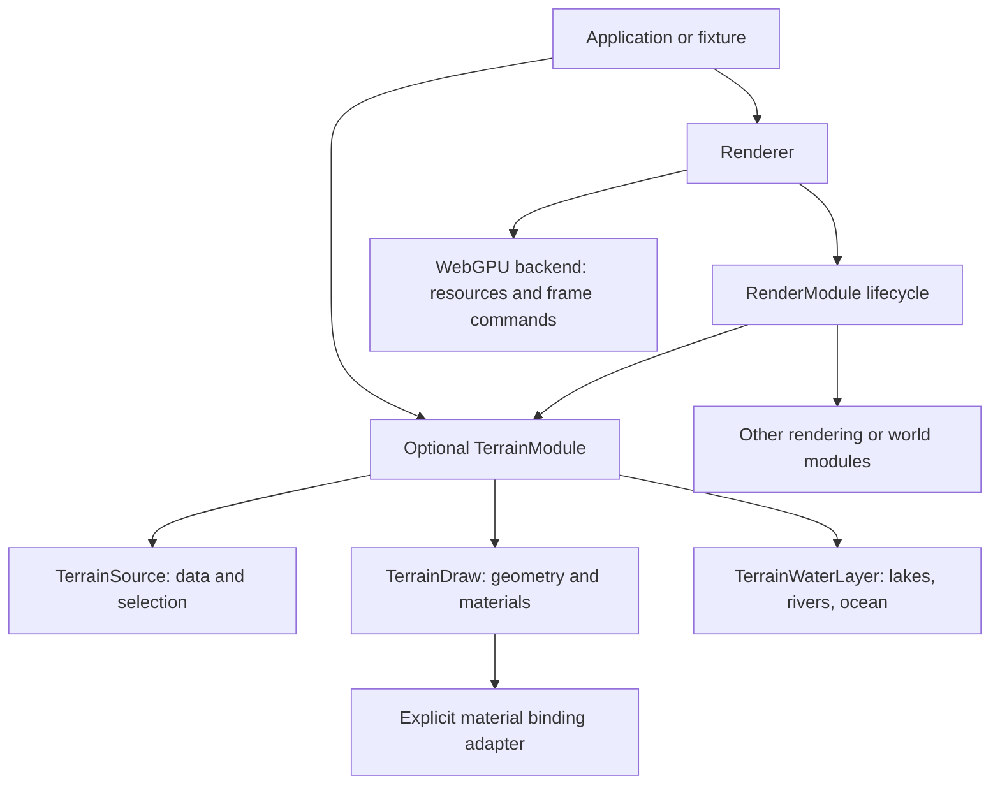

# Renderer and terrain module contracts

The renderer owns frame ordering, the viewport, and submission of the frame command encoder. Applications supply cameras and optional modules. Terrain, planets, textures, lighting, weather, actors, and gameplay are supplied by composition; the core does not initialize them.

The runtime stays in JavaScript. The new renderer and terrain bridge use checked JSDoc, with generated TypeScript class declarations. Small handwritten contracts describe the ports into the existing quadtree draw implementation.

## Files to give an agent

| Task | Start with |
| --- | --- |
| Add a render or compute module | `core/renderer/contracts.d.ts`, `core/renderer/Renderer.js` |
| Supply terrain data or a fixture | `core/renderer/terrain/contracts.d.ts`, `core/renderer/terrain/TerrainModule.js` |
| Use the production terrain shaders | `core/renderer/terrain/QuadtreeTerrainRenderer.d.ts` |
| Change the existing planet assembly | `core/world/PlanetTerrainModule.js` |

Changes to terrain generation still belong in `core/world`; changes to materials and drawing belong in `core/renderer/terrain`. A feature can be implemented against a supplied `TerrainSource` and `TerrainDraw` without changing planetary traversal or bootstrapping the game.

## Composition



The existing `Frontend` is the game composition layer. It uses `Renderer` to run the terrain module and submit frames, and interleaves its sky, actors, asset streaming, lighting, particles, and postprocessing around those phases. Its existing terrain/water properties forward to `PlanetTerrainModule` for compatibility with game diagnostics. Those game extensions continue to receive their dependencies explicitly from the application.

`PlanetTerrainModule` assembles the current `QuadtreeTileManager`, `QuadtreeTerrainRenderer`, ocean, river simulation, erosion-seed lake surfaces, near water, and simulated water surface. It owns its quadtree source and draw resources. The generator, atlases, uniforms, and `WaterGpuData` have application owners. `features.rivers`, `features.lakes`, and the existing `hasOceans` setting can disable their respective layers.

## Minimal renderer

Package entry points are `t0/renderer`, `t0/terrain`, and `t0/resources`. Relative `.js` imports work directly in a browser. Type-only interfaces are exported by the matching declarations.

```ts
import { Renderer, type RenderCamera, type RenderModule } from 't0/renderer';

const renderer = new Renderer({ canvas });
await renderer.initialize();

const module: RenderModule = {
    id: 'my-feature',
    initialize(context) {
        // Create owned GPU resources or await loading here.
    },
    compute(frame, encoder) {
        // Encode simulation into this encoder.
    },
    render(frame) {
        // Draw opaque geometry using frame.backend or its render pass.
    },
    dispose() {
        // Release this module's resources.
    },
};
await renderer.addModule(module);
renderer.renderFrame({ camera, deltaTime: 1 / 60, time: 10 });
renderer.removeModule('my-feature');
renderer.dispose();
```

`canvas` and `camera` come from the caller. A `RenderCamera` contains a position, view matrix (`matrixWorldInverse`), and projection matrix. Matrices are column-major and use WebGPU's `[0, 1]` depth range. The core does not move the camera or infer a world coordinate system. An empty module list produces a cleared frame.

## Terrain source and draw contracts

```ts
import { TerrainModule, type TerrainSource, type TerrainDraw } from 't0/terrain';

// These may come from a full quadtree, a single tile, or a fixture.
declare const source: TerrainSource;
declare const draw: TerrainDraw;
await renderer.addModule(new TerrainModule({ source, renderer: draw }));
```

The module does not discover or construct a concrete world. `TerrainSource` owns data and selection; `TerrainDraw` owns materials, geometry, and draw calls. Pair a source with a draw implementation that understands its buffer format.

| Source method | Contract |
| --- | --- |
| `isReady()` | Whether data can be drawn this frame. |
| `update(camera, encoder)` | Optional selection/streaming work. The frame encoder is borrowed. |
| `getInstanceBuffer()` | The source's draw data. The quadtree renderer expects the 64-byte WGSL `ChunkInstance` layout. |
| `getIndirectArgsBuffer()` / `getIndirectArgsOffsetBytes(lod)` | Indexed indirect arguments, five u32 words per draw; the source defines the offsets. |
| `getArrayTextures()` | Borrowed texture wrappers with explicit formats and array/filtering flags. |
| `updateLodIndexCounts(counts)` | Receives the geometry's index counts so the source can prepare matching indirect arguments. |
| `getTierFadeParameters()` | Optional selection metrics used by the production draw path for distance fading. |
| `resolveFeedbackReadback()` | Optional readback starting after frame submission. |

The quadtree renderer consumes this contract without accessing a concrete `quadtreeGPU` to obtain fade settings. A future quadtree fixture can supply its buffers and textures while implementing selection as a no-op.

## Water and materials

Supply optional `TerrainWaterLayer` objects through `waterLayers`. They receive initialization, CPU update, compute, transparent render, water-data replacement, and disposal callbacks. They can consume a finite source or use independently supplied data. No water layer is required by `Renderer` or `TerrainModule`.

`setWaterData()` passes typed lake/river GPU resources to the terrain draw and its water layers. Passing `null` clears the inputs. Shared water buffers and texture views remain owned by the caller.

Materials must declare `bindGroupLayoutSpec` or `bindingAdapter`. The backend does not infer terrain, sphere, or shadow layouts from a material name. The terrain adapter in `materials/terrainBindings.js` owns the production terrain/water binding layout and uniform packing. An adapter's `cacheKey` identifies its layout family, and `getCacheKey(material)` must include any material settings that change its layouts. Generic materials can use a binding specification without any terrain imports.

Use `backend.destroyMaterial()` to release material-owned uniform buffers and cached bindings when removing a module. Geometry, externally supplied storage buffers, and shared textures have separate owners.

## Frame and lifetime rules

Complete frames run each phase across all modules in registration order:

1. `update` for CPU state.
2. `compute` with one borrowed frame command encoder.
3. `render` for opaque geometry.
4. `renderTransparent` for blended surfaces, including water.
5. Submit the frame encoder, then `afterSubmit` for feedback/readback.

Initialization can be asynchronous while installed modules continue rendering. Installation commits between frames; an application that leaves a split frame active across an asynchronous operation must close it before installation completes. Frame hooks must be synchronous; a returned promise is rejected as a contract violation. Modules must finish their passes and must not submit the borrowed frame encoder. Existing terrain generation and readback may schedule separate background command buffers on the shared device.

For application composition, use `beginFrame`, `compute`, `render`, `renderTransparent`, and `endFrame` in that order. The same frame object is required throughout. On an application exception, call `abortFrame` to discard its unfinished commands. Complete-frame `renderFrame` does this automatically. Module installation, removal, and viewport changes require an idle renderer.

Removing a module disposes it. Renderer disposal runs modules in reverse registration order and continues cleanup if one module throws. A renderer-created backend is owned; an injected backend is borrowed unless `ownsBackend: true` is set. `TerrainModule` owns its draw and water layers. Its source is borrowed and externally initialized by default; opt into `ownsSource` and `initializeSource` for a private world or fixture.

## Verification

Run `npm test` for runtime tests and `npm run typecheck` for checked JavaScript, declaration-only consumers, negative TypeScript contract tests, and declaration freshness. After changing a checked public class, run `npm run types:build` and commit its generated `.d.ts` alongside the JavaScript change. The quadtree draw and generic resource/backend declarations describe maintained interfaces into the existing JavaScript implementation.

Serve with `python3 server.py` and open `http://localhost:8000/wizard_game/standalone.html` to run the existing wizard game.
